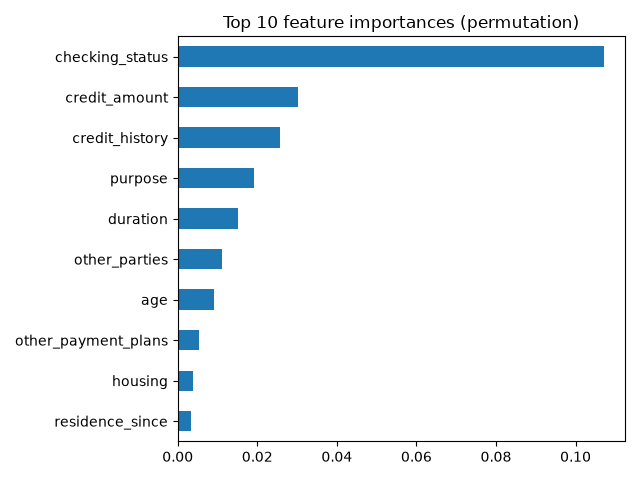

# Credit Risk Prediction with Explainable ML

Predicts whether a loan applicant is a good or bad credit risk using the German Credit dataset (1,000 applicants, 20 features).

## What I did
- Built a preprocessing pipeline (scaling + one-hot encoding) with scikit-learn
- Compared Logistic Regression, Random Forest and Gradient Boosting using 5-fold stratified CV
- Tuned the best model with GridSearchCV
- Evaluated on a held-out test set (ROC-AUC, precision/recall, confusion matrix)
- Explained predictions with permutation feature importance

## Results
| Model | CV ROC-AUC |
|---|---|
| Logistic Regression | 0.xx |
| Random Forest | 0.xx |
| Gradient Boosting (tuned) | 0.xx |

Test ROC-AUC: **0.xx**

## How to run
pip install -r requirements.txt
python train.py

## Tech stack
Python, pandas, scikit-learn, matplotlib